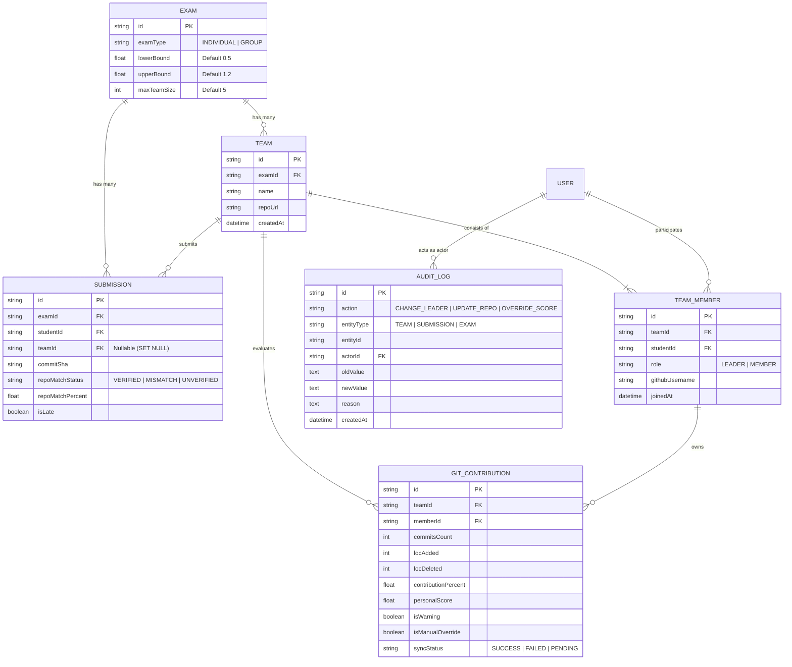

# TÀI LIỆU THIẾT KẾ CƠ SỞ DỮ LIỆU PRISMA
## PHÂN HỆ BÀI THI NHÓM, ĐÓNG GÓP GIT VÀ KIỂM TOÁN (AUDIT LOGS)
**Hệ thống:** AITA-Intelligent (Automated Intelligent Testing Assistant)  
**Tác giả:** Nhóm 5 - Phân hệ 2  
**Milestone:** 2 (Database Architecture & Git Integration)  
**Trạng thái:** Đã triển khai và áp dụng Migration thành công  

---

### 1. Mục tiêu thiết kế
Mở rộng cấu trúc cơ sở dữ liệu PostgreSQL thông qua Prisma ORM nhằm:
1. Hỗ trợ mô hình bài thi nhóm (`GROUP` exam), phân bổ thành viên, nhóm trưởng và quản lý GitHub Repository.
2. Lưu vết và đồng bộ hóa chỉ số đóng góp mã nguồn Git (`GitContribution`: commits, LOC added/deleted, contribution percentage, warning flags).
3. Hỗ trợ liên kết bài nộp nhóm (`Submission` có `teamId`, cờ nộp trễ `isLate`, mã hash `commitSha`, và trạng thái đối chiếu `repoMatchStatus`).
4. Ghi nhận nhật ký kiểm toán hệ thống (`AuditLog`) phục vụ phúc khảo, tra cứu hành vi thay đổi nhóm trưởng, ghi đè điểm số hoặc duyệt bài trễ.

---

### 2. Mô hình Thực thể & Quan hệ (ERD Overview)

---

### 3. Chi tiết các bảng và cấu trúc trường

#### 3.1. Bảng `teams` (Quản lý nhóm thi)
- **Khóa chính:** `id` (`TEXT NOT NULL`, UUID).
- **Trường dữ liệu:**
  - `examId`: Khóa ngoại tham chiếu `exams(id)` với quan hệ `ON DELETE CASCADE`.
  - `name`: Tên nhóm hiển thị (ví dụ: "Group 01", "Team Rocket").
  - `repoUrl`: Đường dẫn repository GitHub của nhóm (ví dụ: `https://github.com/org/repo`).
  - `createdAt`: Thời điểm nhóm được tạo.
- **Ràng buộc & Chỉ mục:**
  - `UNIQUE (examId, name)`: Đảm bảo trong cùng một bài thi không có 2 nhóm trùng tên.
  - `INDEX (examId)`: Tối ưu hóa truy vấn danh sách nhóm theo bài thi.

#### 3.2. Bảng `team_members` (Thành viên nhóm)
- **Khóa chính:** `id` (`TEXT NOT NULL`, UUID).
- **Trường dữ liệu:**
  - `teamId`: Khóa ngoại tham chiếu `teams(id)` với quan hệ `ON DELETE CASCADE`.
  - `studentId`: Khóa ngoại tham chiếu `users(id)` với quan hệ `ON DELETE CASCADE`.
  - `role`: Phân cấp vai trò (`LEADER` hoặc `MEMBER`).
  - `githubUsername`: Tên tài khoản GitHub của sinh viên dùng để match commit author.
  - `joinedAt`: Thời điểm gia nhập.
- **Ràng buộc & Chỉ mục:**
  - `UNIQUE (teamId, studentId)`: Ngăn chặn một sinh viên xuất hiện nhiều lần trong cùng một nhóm.
  - `INDEX (teamId)` và `INDEX (studentId)`.

#### 3.3. Bảng `git_contributions` (Chỉ số đóng góp Git)
- **Khóa chính:** `id` (`TEXT NOT NULL`, UUID).
- **Trường dữ liệu:**
  - `teamId`: Khóa ngoại tham chiếu `teams(id)`.
  - `memberId`: Khóa ngoại tham chiếu `team_members(id)`.
  - `commitsCount`, `locAdded`, `locDeleted`: Chỉ số telemetry thô từ GitHub API.
  - `contributionPercent`: Tỷ lệ đóng góp thực tế (%) của thành viên trên tổng thể nhóm.
  - `personalScore`: Điểm số cá nhân sau khi áp dụng trọng số đóng góp từ điểm nhóm.
  - `isWarning`: Cờ cảnh báo tự động khi tỷ lệ đóng góp dưới ngưỡng tối thiểu (ngưỡng 5%).
  - `isManualOverride`: Đánh dấu nếu giảng viên đã chỉnh sửa điểm thủ công.
  - `syncStatus` & `syncError`: Trạng thái đồng bộ từ GitHub (`SUCCESS`, `FAILED`, `PENDING`).
- **Ràng buộc & Chỉ mục:**
  - `UNIQUE (teamId, memberId)`: Mỗi thành viên trong nhóm chỉ có đúng 1 bản ghi đóng góp cho bài thi đó.

#### 3.4. Bảng `audit_logs` (Nhật ký kiểm toán minh bạch)
- **Khóa chính:** `id` (`TEXT NOT NULL`, UUID).
- **Trường dữ liệu:**
  - `action`: Hành động nghiệp vụ (`CHANGE_LEADER`, `UPDATE_REPO`, `OVERRIDE_SCORE`, `LATE_APPROVAL`).
  - `entityType`: Loại đối tượng (`TEAM`, `SUBMISSION`, `EXAM`).
  - `entityId`: ID đối tượng bị tác động.
  - `actorId`: ID người thực hiện (tham chiếu `users(id)`).
  - `oldValue`, `newValue`: Snapshot JSON hoặc chuỗi giá trị trước và sau khi thay đổi.
  - `reason`: Lý do giảng viên thực hiện hành động.
  - `createdAt`: Thời điểm ghi log.
- **Chỉ mục:** `INDEX (entityType, entityId)` và `INDEX (actorId)` phục vụ tìm kiếm vết kiểm toán tức thì.

---

### 4. Tinh chỉnh từ phía Sinh viên (Student's Validation & Technical Decisions)

Trong quá trình tiếp nhận đề xuất từ AI, sinh viên đã rà soát và thực hiện các điều chỉnh quan trọng:

1. **Chính sách xóa khóa ngoại (`ON DELETE` Policy):**
   - AI đề xuất dùng `ON DELETE CASCADE` cho toàn bộ quan hệ.
   - **Sinh viên điều chỉnh:** 
     - Với `submissions(teamId)` chuyển sang `ON DELETE SET NULL`: Khi giải tán một nhóm sau kỳ thi, toàn bộ bài nộp và mã nguồn của sinh viên vẫn được bảo lưu nguyên vẹn để làm bằng chứng kiểm toán học tập.
     - Với `audit_logs` bảo lưu toàn bộ lịch sử thao tác, không cho phép xóa cascading làm mất dấu vết gian lận hoặc sửa điểm.
2. **Xử lý bất đồng bộ và chống xung đột (Concurrency & Lock):**
   - Thiết lập chỉ mục phức hợp `UNIQUE (teamId, studentId)` và `UNIQUE (examId, name)` ở tầng Database để ngăn race condition khi nhiều sinh viên cùng gửi yêu cầu vào nhóm hoặc tạo nhóm cùng lúc.
3. **Phân tách cờ trạng thái đồng bộ:**
   - Bổ sung `isManualOverride`, `syncStatus`, `syncError` vào bảng `git_contributions` để khi GitHub API gặp sự cố (Rate Limit HTTP 403 hoặc Repo Private), hệ thống ghi nhận lỗi cục bộ mà không làm sập giao diện chấm bài của giảng viên.

---

### 5. Lịch sử Migration thực tế trong Codebase
Các migration đã được tạo và thực thi trong dự án:
- `20261014000000_group_exam_git_analytics`: Khởi tạo bảng `teams`, `team_members`, `git_contributions`, và mở rộng `exams.examType`, `submissions.teamId`.
- `20261016132634_group_exam_audit_and_scoring`: Thêm bảng `audit_logs`, mở rộng các trường `exams.lowerBound`, `exams.upperBound`, `git_contributions.isManualOverride`, `submissions.isLate`.
- `20261017043600_add_submission_repo_matching`: Bổ sung các trường đối chiếu commit SHA và Git Tree.
